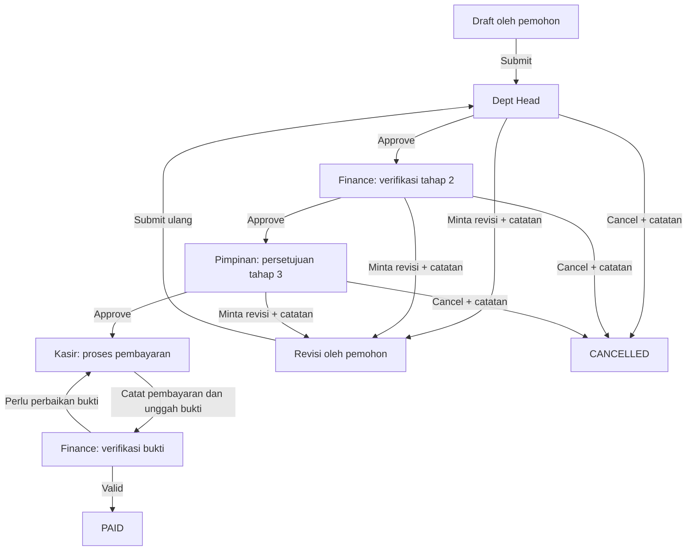

# Implementation Plan: Approval Workflow PPD

## Tujuan

Membangun alur PPD dari pengajuan sampai bukti pembayaran dengan persetujuan berurutan oleh Dept Head, Finance, dan Pimpinan. Setiap keputusan harus dibatasi oleh role dan tahap PPD, tersimpan sebagai riwayat audit, dan terlihat oleh pemohon. PPD yang dikembalikan untuk revisi dapat diedit oleh pemohon dan dikirim ulang. Setelah persetujuan Pimpinan, proses pembayaran dan verifikasi bukti pembayaran diselesaikan oleh Kasir dan Finance.

## Kondisi Proyek Saat Ini

- Role Prisma yang tersedia: `ADMIN`, `EXECUTIVE`, `FINANCE`, `DEPT_HEAD`, dan `STAFF`. Label `EXECUTIVE` di UI sudah ditampilkan sebagai Pimpinan.
- Belum ada role `CASHIER`. Jika Kasir adalah pengguna terpisah, role ini perlu ditambahkan ke enum Prisma, form user, label role, navigasi, dan pemeriksaan route/action.
- Status `PPDStatus` saat ini adalah `DRAFT`, `SUBMITTED`, `APPROVED_DEPT`, `APPROVED_FINANCE`, `PAID`, dan `REJECTED`. Status ini belum membedakan persetujuan Finance tahap verifikasi, persetujuan Pimpinan, dan antrean pembayaran.
- `submitPpdDraftAction` saat ini mengubah status menjadi `SUBMITTED`; belum ada action approval, catatan revisi, atau histori keputusan.
- `PPDRequest` menyimpan pemohon, departemen, periode, jenis pengajuan, dan status. `PPDItem` menyimpan akun anggaran, deskripsi, jumlah, dan satu URL lampiran.
- Data PPD saat ini dimuat untuk pemohon. Finance punya cakupan departemen aktif yang lebih luas, tetapi antrean Dept Head/Pimpinan/Kasir belum tersedia.
- Reservasi anggaran PPD dihitung dari status dan item PPD; perubahan status alur baru harus menjaga aturan reservasi yang sudah diterapkan.

## Alur Status yang Diusulkan

| Status | Pemilik tindakan | Tindakan yang tersedia | Status berikutnya |
| --- | --- | --- | --- |
| `DRAFT` | Pemohon | Simpan, edit, hapus, submit | `PENDING_DEPT_HEAD` saat submit |
| `PENDING_DEPT_HEAD` | Dept Head departemen terkait | Approve, minta revisi, cancel | `PENDING_FINANCE`, `RETURNED_FOR_REVISION`, atau `CANCELLED` |
| `PENDING_FINANCE` | Finance | Approve/verifikasi, minta revisi, cancel | `PENDING_EXECUTIVE`, `RETURNED_FOR_REVISION`, atau `CANCELLED` |
| `PENDING_EXECUTIVE` | Pimpinan (`EXECUTIVE`) | Approve, minta revisi, cancel | `PENDING_CASHIER`, `RETURNED_FOR_REVISION`, atau `CANCELLED` |
| `RETURNED_FOR_REVISION` | Pemohon | Lihat catatan, edit, kirim ulang | `PENDING_DEPT_HEAD` saat dikirim ulang |
| `PENDING_CASHIER` | Kasir | Catat pembayaran dan unggah bukti | `PENDING_FINANCE_PAYMENT_CHECK` |
| `PENDING_FINANCE_PAYMENT_CHECK` | Finance | Verifikasi bukti, minta perbaikan bukti | `PAID` atau kembali ke `PENDING_CASHIER` |
| `PAID` | Tidak ada tindakan lanjutan | Lihat detail dan riwayat | Terminal |
| `CANCELLED` | Tidak ada tindakan lanjutan | Lihat detail dan riwayat | Terminal |

`REJECTED` yang sudah ada perlu dipetakan dengan tegas. Rekomendasi: gunakan `CANCELLED` untuk permintaan pembatalan yang disetujui reviewer, dan pertahankan `REJECTED` hanya jika bisnis memang membedakan penolakan final dari pembatalan. Jangan memakai dua status tersebut dengan arti yang sama.

### Diagram alur

## Model Data dan Migrasi

### 1. Perluas status PPD

- Tambahkan status tahap eksplisit: `PENDING_DEPT_HEAD`, `PENDING_FINANCE`, `PENDING_EXECUTIVE`, `RETURNED_FOR_REVISION`, `PENDING_CASHIER`, `PENDING_FINANCE_PAYMENT_CHECK`, dan `CANCELLED`.
- Pertahankan `DRAFT` dan `PAID`. Pertahankan atau rapikan `SUBMITTED`, `APPROVED_DEPT`, `APPROVED_FINANCE`, serta `REJECTED` setelah data lama dipetakan.
- Buat migrasi data untuk status lama. Minimal, PPD lama berstatus `SUBMITTED` diarahkan ke `PENDING_DEPT_HEAD`. Status approval lama harus dipetakan berdasarkan arti pemakaiannya di data produksi sebelum migrasi dijalankan.
- Jangan menghapus enum lama dalam migrasi yang sama sebelum seluruh nilai lama dipindahkan dan diverifikasi.

### 2. Tambahkan histori keputusan

Buat model misalnya `PPDApprovalEvent` dengan kolom:

- `id`, `requestId`, `actorId`, dan waktu kejadian.
- `stage` untuk Dept Head, Finance, Pimpinan, Kasir, atau verifikasi pembayaran.
- `action` seperti submitted, approved, revision requested, cancelled, payment recorded, payment proof returned, dan paid.
- `fromStatus`, `toStatus`, serta `note`.
- Relasi ke `PPDRequest` dan `User`; index pada `requestId` dan waktu.

Riwayat bersifat append-only dari UI. Setiap pengiriman ulang membuat event baru; event revisi dan keputusan sebelumnya tidak ditimpa.

### 3. Tambahkan data bukti pembayaran

Buat model misalnya `PPDPaymentProof` yang terhubung ke `PPDRequest`. Versi pertama dapat menyimpan satu catatan pembayaran per PPD dengan nama file asli, path privat, tipe file, ukuran, nominal yang dibayar, tanggal pembayaran, nomor referensi, pengunggah, dan catatan Finance. Jika pembayaran bertahap dibutuhkan, ubah menjadi beberapa catatan pembayaran per PPD sebelum implementasi.

Simpan file di storage privat yang sama dengan lampiran PPD atau storage object yang dipakai proyek. Jangan menaruh bukti pembayaran sensitif di URL publik. Route baca dan upload harus melakukan autentikasi serta otorisasi berdasarkan tahap dan role.

### 4. Role dan cakupan departemen

- Tambahkan `CASHIER` jika Kasir merupakan akun/role terpisah. Perbarui `prisma/schema.prisma`, pilihan role di manajemen user, nama role, route permissions, dan menu.
- Dept Head hanya dapat melihat dan bertindak pada PPD yang departemennya ditugaskan kepadanya sebagai PIC aktif.
- Finance dapat melihat antrean Finance pada departemen yang sesuai kebijakan saat ini; cakupan Finance yang sekarang adalah semua departemen aktif.
- Pimpinan hanya dapat bertindak pada tahap `PENDING_EXECUTIVE`. Proyek saat ini belum memberi `EXECUTIVE` cakupan antrean PPD lintas departemen, sehingga perlu query khusus untuk tahap approval ini.
- Kasir hanya dapat melihat `PENDING_CASHIER` dan mengunggah data/bukti pembayaran. Kasir tidak dapat mengubah item atau keputusan approval sebelumnya.
- Admin dapat memantau seluruh PPD. Hak Admin untuk melakukan approval atas nama role lain harus ditetapkan secara eksplisit; rekomendasi awal adalah Admin hanya memantau dan tidak menggantikan tanda persetujuan.
- Semua pembatasan diterapkan di server action dan query data, bukan hanya dengan menyembunyikan tombol.

## Rencana Implementasi Backend

### Tahap 1 — Transisi status dan validasi server

- Ubah `submitPpdDraftAction` agar hanya menerima draft milik pemohon yang masih `DRAFT` atau `RETURNED_FOR_REVISION`, memvalidasi data dan akses departemen, lalu mengubah status menjadi `PENDING_DEPT_HEAD`.
- Tambahkan action generik atau action khusus per tahap untuk approve, minta revisi, dan cancel. Setiap action menerima ID PPD, keputusan, dan catatan; role serta identitas aktor diambil dari sesi server.
- Sebelum mutasi, muat ulang PPD beserta departemen dan statusnya. Tolak jika status tidak sama dengan tahap yang diharapkan atau aktor tidak berwenang.
- Perubahan status dan pembuatan `PPDApprovalEvent` dilakukan dalam satu transaksi. Gunakan update bersyarat berdasarkan status saat ini agar dua reviewer tidak dapat memproses PPD yang sama bersamaan.
- Catatan wajib untuk `RETURNED_FOR_REVISION`, `CANCELLED`, serta pengembalian bukti pembayaran. Untuk approve, catatan opsional.
- Setiap action melakukan `revalidatePath` pada antrean PPD, detail pemohon, dan dashboard anggaran yang terdampak.

### Tahap 2 — Revisi oleh pemohon

- Izinkan `savePpdDraftAction` mengubah PPD milik pemohon dengan status `DRAFT` atau `RETURNED_FOR_REVISION` saja.
- Saat PPD dikembalikan, tampilkan catatan reviewer, nama tahap yang mengembalikan, dan waktunya.
- Setelah pemohon mengirim ulang, status kembali ke `PENDING_DEPT_HEAD`; event approval sebelumnya tetap di riwayat.
- PPD yang sedang menunggu approval, pembayaran, sudah dibayar, atau dibatalkan tidak dapat diedit pemohon.

### Tahap 3 — Query antrean yang terotorisasi

- Pisahkan query daftar PPD milik pemohon dari query antrean reviewer.
- Query Dept Head hanya mengembalikan status `PENDING_DEPT_HEAD` untuk departemen dengan PIC aktif yang cocok dengan user.
- Query Finance hanya mengembalikan PPD pada `PENDING_FINANCE` dan `PENDING_FINANCE_PAYMENT_CHECK`.
- Query Pimpinan hanya mengembalikan `PENDING_EXECUTIVE`.
- Query Kasir hanya mengembalikan `PENDING_CASHIER`.
- Ambil histori approval untuk detail PPD; jangan mengirim data sensitif PPD departemen lain ke client lalu menyaringnya di browser.

### Tahap 4 — Pembayaran dan verifikasi bukti

- Kasir mencatat nominal/tanggal pembayaran dan mengunggah dokumen bukti melalui endpoint yang membatasi tipe serta ukuran file.
- Setelah bukti tersimpan, status menjadi `PENDING_FINANCE_PAYMENT_CHECK` dan Finance mendapat antrean verifikasi.
- Finance dapat mengonfirmasi bukti atau mengembalikannya ke Kasir dengan catatan wajib. Finance tidak mengubah item pengajuan pada tahap ini.
- Saat Finance mengonfirmasi pembayaran, transaksi mengubah status menjadi `PAID`, menambahkan realisasi ke `MonthlyBudget` untuk akun/periode item terkait, dan menulis event audit.
- Pastikan proses pembayaran tidak menggandakan realisasi jika action dipanggil ulang. Gunakan status asal yang disyaratkan dan transaksi idempotent.

## Rencana UI

### Navigasi dan halaman

- Tambahkan menu **Approval PPD** dengan badge jumlah item yang menunggu role aktif.
- Buat antrean bersama dengan filter tahap/status, departemen, periode, pemohon, dan pencarian nomor/judul PPD.
- Tampilkan kolom minimal: nomor PPD, pemohon, departemen, tanggal submit, total, tahap, dan aksi buka detail.
- Pemohon mendapat daftar PPD miliknya dengan status terkini, catatan revisi, dan riwayat proses.

### Detail dan aksi

- Tampilkan rincian permohonan, baris laporan pertanggungjawaban, total, lampiran, sisa/reservasi anggaran, dan timeline keputusan.
- Dept Head, Finance tahap verifikasi, dan Pimpinan mendapat tombol **Approve**, **Minta revisi**, dan **Cancel** sesuai tahap aktif.
- Aksi revisi/cancel membuka dialog berisi textarea catatan wajib dan konfirmasi sebelum dikirim.
- Kasir mendapat formulir pembayaran dan tabel bukti pembayaran. Finance tahap akhir mendapat tampilan baca-saja bukti serta tombol **Verifikasi pembayaran** atau **Kembalikan ke Kasir**.
- Tombol aksi menampilkan status proses, mencegah submit ganda, dan memberi feedback sukses/error. Setelah aksi berhasil, item hilang dari antrean aktif role tersebut.

## Kebijakan Reservasi Anggaran

- Reservasi dihitung dari jumlah item per akun, bulan, dan tahun pada PPD `UANG_MUKA` yang aktif.
- Status yang menahan reservasi: `DRAFT`, seluruh tahap approval, `RETURNED_FOR_REVISION`, `PENDING_CASHIER`, dan `PENDING_FINANCE_PAYMENT_CHECK`.
- Status `CANCELLED` atau `REJECTED` melepas reservasi. `PAID` juga tidak lagi dihitung sebagai reservasi karena nominalnya sudah dipindahkan ke realisasi.
- Sisa yang ditampilkan adalah `anggaran - realisasi - reservasi aktif`. Draft yang dikembalikan untuk revisi tetap menahan reservasi agar pengajuan tidak memakai saldo yang sama selama proses koreksi.
- Ketika menyimpan perubahan draft, perhitungan mengganti reservasi PPD lama dengan total item terbaru; jangan menambahkan total baru di atas nilai lama.
- Saat mengirim atau memproses pembayaran, perubahan status tidak boleh membuat reservasi dihitung dua kali. Verifikasi bahwa pindah dari reservasi ke realisasi hanya terjadi sekali.
- Putuskan apakah sistem harus menolak submit yang melebihi saldo tersedia. Rekomendasi: validasi di server dengan mengecualikan reservasi PPD yang sedang diedit, dan tetap menghitung ulang dalam transaksi agar dua PPD bersamaan tidak menghabiskan saldo yang sama.

## Urutan Pengerjaan

1. Konfirmasi apakah Kasir adalah role terpisah dan apakah Finance hanya memverifikasi bukti atau juga mencatat pembayaran.
2. Sepakati arti `REJECTED` versus `CANCELLED`, aturan catatan wajib, dan apakah saldo berlebih harus menolak submit.
3. Tambahkan status, event approval, model bukti pembayaran, indeks, dan migrasi/backfill status lama.
4. Implementasikan query terotorisasi dan action transisi backend dengan transaksi serta validasi role/status.
5. Implementasikan revisi pemohon dan histori PPD.
6. Bangun antrean serta halaman detail Dept Head, Finance, dan Pimpinan.
7. Tambahkan role/menu Kasir jika disepakati, lalu implementasikan unggah bukti dan verifikasi Finance.
8. Selaraskan reservasi anggaran dan proses transfer reservasi menjadi realisasi ketika dibayar.
9. Verifikasi transisi normal, revisi dari tiap tahap, cancel, akses lintas departemen, pengiriman ganda, dan pembayaran berulang.

## Kriteria Penerimaan

- Submit hanya dapat dilakukan pemilik PPD dan memulai antrean Dept Head.
- Dept Head hanya melihat PPD pada departemen tanggung jawabnya dan hanya bertindak saat status `PENDING_DEPT_HEAD`.
- Approve Dept Head meneruskan ke Finance; approve Finance meneruskan ke Pimpinan; approve Pimpinan meneruskan ke proses pembayaran.
- Approve/cancel/revisi dari role atau tahap yang salah ditolak server meskipun action dipanggil langsung.
- Permintaan revisi dari setiap tahap wajib memiliki catatan; pemohon dapat mengedit PPD yang dikembalikan dan submit ulang dari awal.
- Histori menampilkan aktor, tahap, keputusan, catatan, dan waktu secara berurutan.
- Kasir hanya dapat mencatat pembayaran dan bukti untuk PPD pada antreannya; Finance dapat mengembalikan bukti atau memverifikasi pembayaran.
- PPD yang dibayar hanya menambah realisasi satu kali; PPD cancel/reject tidak lagi mengurangi saldo tersedia.
- Reservasi PPD tetap konsisten saat draft disimpan berulang kali, direvisi, disubmit, dibatalkan, atau dibayar.
- Pemohon, reviewer, dan Kasir hanya melihat detail/lampiran sesuai hak akses; request ID yang dimanipulasi tidak membuka PPD departemen lain.

## Keputusan yang Masih Perlu Disepakati

1. Apakah Kasir adalah role login terpisah (`CASHIER`), atau proses pembayaran dilakukan Finance?
A: Cashier di proses oleh Finance
2. Setelah Kasir mengunggah bukti, apakah Finance wajib memverifikasi sebelum status `PAID`?
A: ya, setelah mengunggah bukti finance harus klik tombol submit sebagai verifikasi baru statusnya PAID
3. Apakah reviewer boleh membatalkan PPD di semua tahap, atau hanya meminta revisi/menolak?
A: tidak, reviewer hanya boleh membatalkan ppd saat statusnya ada dibawahnya bukan diatasnya
4. Apakah revisi dari Finance/Pimpinan selalu kembali ke Dept Head setelah pemohon submit ulang?
A: jika ada revisi maka hanya akan kembali ke 1 tingkat dibawahnya, jadi 1 tingkat dibawahnya yang jadi tanggung jawab
5. Apakah pembayaran boleh bertahap dan memiliki beberapa bukti, atau satu pembayaran final per PPD?
A: Satu pembayaran finnal
6. Apakah submit harus ditolak ketika total reservasi melebihi sisa anggaran?
A: kalo reservasi melebihi sisa anggaran maka tidak bisa disubmit