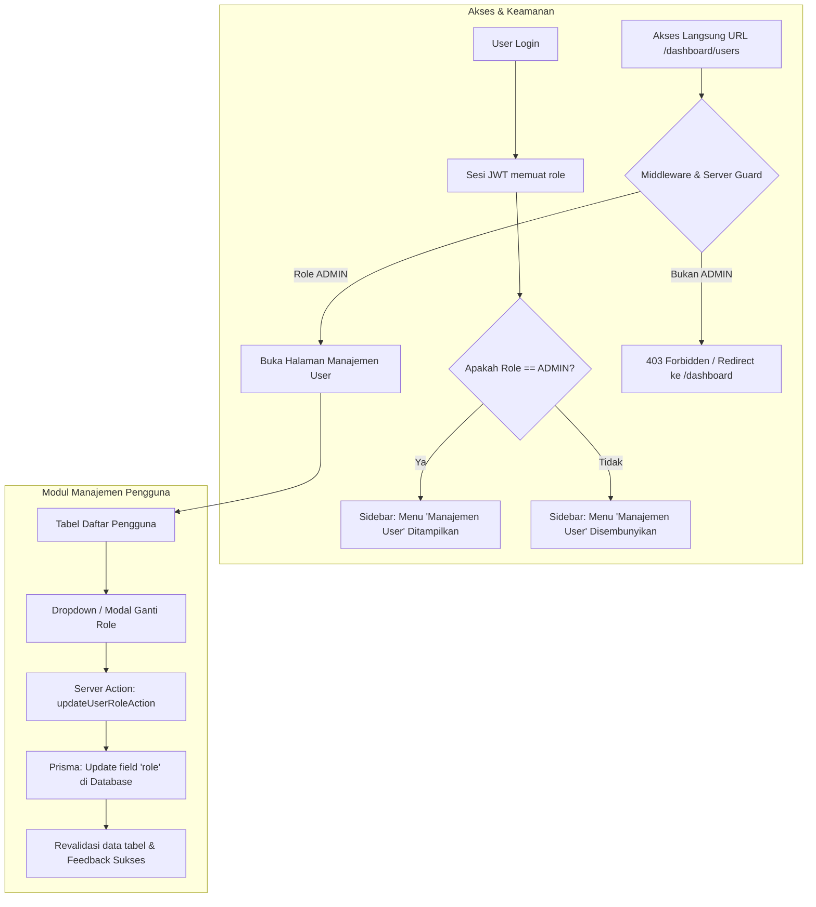

# Implementation Plan: Manajemen User & Pengaturan RBAC (Khusus Admin)

## 📌 Ringkasan Fitur
Menyediakan modul **Manajemen Pengguna (User & Role Management)** di dalam Dashboard (`/dashboard/users`) yang memungkinkan akun dengan role **`ADMIN`** untuk:
1. Melihat daftar seluruh pengguna beserta role aktifnya (`ADMIN`, `EXECUTIVE`, `FINANCE`, `DEPT_HEAD`, `STAFF`).
2. Mengubah role pengguna secara dinamis langsung dari antarmuka dashboard.
3. Membatasi menu sidebar dan akses rute URL sehingga **hanya role `ADMIN`** yang dapat melihat dan membuka menu ini.

---

## 🏗️ Alur Sistem & Arsitektur



---

## 📋 Tahapan Implementasi

### Tahap 1: Proteksi Navigasi & Sidebar (UI Level)
- **Tujuan**: Memastikan menu "Pengguna & Role" hanya terlihat oleh user dengan role `ADMIN`.
- **Langkah Kerja**:
  1. Update komponen [`components/app-sidebar.tsx`](file:///c:/Users/Hp/OneDrive/Documents/bdeul/code/erp-bazma/components/app-sidebar.tsx) agar menerima prop data user yang login (khususnya `role`).
  2. Tambahkan konfigurasi filter:
     ```ts
     // Contoh item menu
     {
       title: "Kelola Pengguna",
       url: "/dashboard/users",
       icon: UsersIcon,
       roles: [Role.ADMIN] // Hanya role ADMIN
     }
     ```
  3. Filter item menu sebelum dirender sehingga role non-admin tidak melihat menu ini.

---

### Tahap 2: Proteksi Rute di Level Middleware & Server Component (Security Guard)
- **Tujuan**: Mencegah role selain `ADMIN` mengakses `/dashboard/users` dengan mengetik URL secara langsung.
- **Langkah Kerja**:
  1. Perbarui [`middleware.ts`](file:///c:/Users/Hp/OneDrive/Documents/bdeul/code/erp-bazma/middleware.ts):
     - Jika rute diawali dengan `/dashboard/users`, periksa `session.role`.
     - Jika `session.role !== "ADMIN"`, redirect ke `/dashboard` dengan parameter alert atau status 403.
  2. Tambahkan proteksi ganda (*defense-in-depth*) di Server Component `app/dashboard/users/page.tsx` menggunakan `getCurrentUser()`:
     ```ts
     const user = await getCurrentUser();
     if (!user || user.role !== "ADMIN") {
       redirect("/dashboard");
     }
     ```

---

### Tahap 3: Server Action untuk Mengubah Role Pengguna
- **Tujuan**: Menyediakan operasi backend yang aman untuk memperbarui role pengguna di database.
- **File Target**: `app/actions/user.ts`
- **Langkah Kerja**:
  1. Verifikasi kredensial pemanggil: Pastikan sesi yang memanggil aksi ini adalah `ADMIN`.
  2. Validasi input: Pastikan role baru merupakan salah satu dari enum `Role` (`ADMIN`, `EXECUTIVE`, `FINANCE`, `DEPT_HEAD`, `STAFF`).
  3. Mencegah admin menghapus/mengubah role dirinya sendiri menjadi non-admin (pencegahan terkunci dari sistem).
  4. Eksekusi `prisma.user.update({ where: { id: targetUserId }, data: { role: newRole } })`.
  5. Panggil `revalidatePath("/dashboard/users")` untuk memperbarui data tampilan secara instan.

---

### Tahap 4: Halaman Dashboard Manajemen Pengguna (`/dashboard/users`)
- **Tujuan**: Menyediakan antarmuka tabel pengguna dan kontrol pergantian role.
- **Komponen yang Dibuat**:
  1. **`app/dashboard/users/page.tsx`**: Server component untuk query daftar user (`prisma.user.findMany()`).
  2. **Tabel Pengguna (`components/users/user-table.tsx`)**:
     - Kolom: Nama, Email, Role Saat Ini, Tanggal Bergabung, dan Aksi.
     - Badge visual untuk setiap role (misal: `ADMIN` merah/primer, `FINANCE` hijau, `STAFF` netral).
  3. **Komponen Pengubah Role (`components/users/role-selector.tsx`)**:
     - Dropdown select untuk memilih role baru.
     - Konfirmasi dialog saat menaikkan/menurunkan hak akses pengguna.
     - State loading dan toast/alert feedback.

---

### Tahap 5: Halaman Layout Dashboard Terintegrasi
- **Tujuan**: Menghubungkan sesi user login ke sidebar secara seamless di `app/dashboard/layout.tsx`.
- **Langkah Kerja**:
  1. Buat/perbarui `app/dashboard/layout.tsx` sebagai Server Component.
  2. Ambil data sesi pengguna via `getCurrentUser()`.
  3. Teruskan user ke `<AppSidebar user={user} />`.
  4. Tampilkan informasi user yang sedang aktif beserta lencana rolenya di sidebar footer.

---

## 🛡️ Aturan Keamanan & Best Practices
- **Self-Demotion Guard**: Admin tidak boleh dapat mengubah rolenya sendiri menjadi non-admin agar tidak terjadi insiden terkunci (*lockout*).
- **Audit Field**: Menggunakan timestamp `updatedAt` otomatis di Prisma setiap kali role diubah.
- **Re-Authentication / Token Refresh**: Jika user yang sedang login diubah rolenya oleh Admin, sesi mereka akan menyesuaikan saat token diperbarui atau saat login ulang.

---

## 🔍 Rencana Pengujian (Testing)
1. **Login sebagai `admin@smktibazma.sch.id`**:
   - Menu "Kelola Pengguna" muncul di sidebar.
   - Halaman `/dashboard/users` dapat dibuka.
   - Berhasil mengubah role user lain dari `STAFF` ke `FINANCE`.
2. **Login sebagai user non-admin (misal: role `STAFF`)**:
   - Menu "Kelola Pengguna" **tidak muncul** di sidebar.
   - Mencoba membuka `http://localhost:3000/dashboard/users` secara langsung **otomatis dialihkan** ke `/dashboard`.
